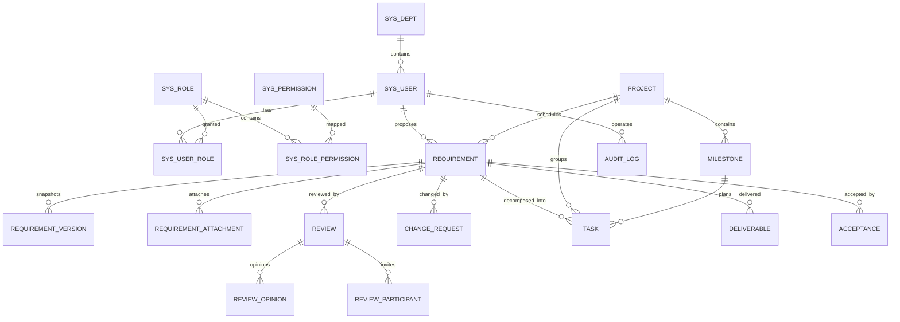

# ReqFlow · 需求管理与交付协同平台

## Requirement Management & Delivery Collaboration Platform

面向“甲方业务部门 + 乙方交付团队”的轻量级需求全生命周期管理平台：需求从提出、受理、评审、排期、任务分解、开发测试，到验收、归档，全过程在线留痕；变更可控、版本可追溯、交付可验收。

*An end-to-end requirement lifecycle platform for business requesters and delivery teams, covering submission, acceptance, review, scheduling, task breakdown, development & testing, acceptance, and archiving, with traceable changes, versions, and deliverables.*

---

## 功能特性 · Features

- **认证与权限 Authentication & RBAC**：账号密码登录、JWT（2 小时）、BCrypt 加盐、连续 5 次失败锁定 15 分钟（失败计数独立事务，不会随登录异常回滚）、修改密码、首次登录改密标记；7 类内置角色、38 个权限点（含 13 个动作级权限点）、接口级 `@PreAuthorize` 校验、状态机与越权判断均按权限点驱动、前端菜单/按钮按权限显隐。
- **数据权限 Data Scope**：ALL / DEPT / PROJECT / SELF 四档；列表、详情、导出、跨表查询复用同一套谓词，单条操作二次校验，越权统一返回 403。
- **需求管理 Requirement**：需求单增删改查、编号自动生成、分页与七类筛选、逻辑删除、标签、关注人视图。
- **需求状态机 State Machine**：动作驱动、服务端计算目标状态、非法流转拒绝并保持原状态；挂起/恢复保留挂起前状态。
- **评审与变更 Review & Change**：发起评审、评审意见（通过/需修改/反对）、主持人结论、驳回返工；变更申请、影响工时/范围、审批、实施生效，版本号递增并生成 JSON 快照。
- **计划与任务 Planning & Tasks**：项目、里程碑、任务分解、负责人、预估/实际工时、任务状态机、逾期标记、验收不通过自动创建返工任务。
- **交付与验收 Delivery & Acceptance**：交付物登记（可上传文件）、必备交付物校验、验收单多轮次、通过/不通过、返工要求、归档只读。
- **附件与导出 Attachment & Export**：20MB 限制、8 类后缀白名单、UUID 落盘、下载校验数据权限；按当前筛选条件导出需求清单 Excel（冻结表头、筛选器）。
- **看板 Dashboard**：指标卡、状态分布、部门分布、近 6 个月趋势、我的待办；统计使用数据库分组聚合。
- **审计 Audit**：`@Audit` 注解 + AOP 统一采集操作人、角色、IP、URI、对象、结果、耗时、追踪号，只读查询。

---

## 文档 · Documentation

| 文档 | 内容 |
|---|---|
| [需求规格说明书](docs/01-需求规格说明书.md) | 角色、流程、功能需求、状态机、业务规则、验收标准 |
| [接口文档](docs/02-接口文档.md) | 通用约定、错误码、50 个接口操作；契约见 [openapi.json](docs/api/openapi.json) |
| [数据库设计说明](docs/03-数据库设计说明.md) | 20 张表、字段、索引、ER 关系、迁移与备份 |
| [测试报告](docs/04-测试报告.md) | 33 个自动化用例结果、手工验收清单、风险 |
| [部署手册](docs/05-部署手册.md) | H2 / MySQL / jar / Docker 四种部署方式与排障 |
| [需求调研纪要](docs/06-需求调研纪要.md) | 角色化模拟访谈与需求归纳方法 |
| [需求池](docs/07-需求池.md) | 45 条需求的优先级、状态与裁剪理由 |
| [需求追溯矩阵](docs/08-需求追溯矩阵.md) | 需求 → 接口 → 代码 → 测试的双向追溯 |
| [验收记录](docs/09-验收记录.md) | 自测验收结果、遗留问题与投递前清单 |

完整索引见 [docs/README.md](docs/README.md)。

---

## 架构设计 · Architecture

采用 **前后端分离 + 单体分层** 架构，后端按 Controller → Service → Mapper 逐层收敛职责，横切能力统一由 AOP 与过滤器提供：

```
┌──────────────────┐      ┌──────────────────┐      ┌─────────────────────────────┐
│   Vue 3 SPA      │      │      Nginx       │      │   Spring Boot 3.3（单体分层） │
│   Element Plus   │ ───▶ │  静态资源 / 反向代理 │ ───▶ │   Controller → Service      │
│   Pinia / Router │      │                  │      │   → Mapper → Database       │
└──────────────────┘      └──────────────────┘      └──────────────┬──────────────┘
                                                                   │
                    ┌──────────────────────────────────────────────┼──────────────────────────────┐
                    ▼                          ▼                   ▼                              ▼
             ┌────────────┐            ┌────────────┐      ┌──────────────┐               ┌────────────┐
             │ MySQL 8/H2 │            │   Flyway   │      │  本地附件存储  │               │  审计日志表  │
             └────────────┘            └────────────┘      └──────────────┘               └────────────┘
```

分层职责：

- **View 层**：Vue 3 SPA，路由守卫按权限点控制页面，Axios 拦截器统一处理 401 与错误提示。
- **Controller 层**：只做参数绑定与权限声明（`@PreAuthorize`），不写业务逻辑。
- **Service 层**：负责事务边界、状态机流转、数据权限校验与业务编排。
- **Mapper 层**：以 MyBatis-Plus 单表 CRUD 为主，复杂统计使用注解 SQL。
- **横切能力**：统一响应体 `Result<T>`、统一异常 `GlobalExceptionHandler`、JWT 过滤器、审计 AOP。

---

## 技术栈 · Tech Stack

### 后端 · Backend

| 类别 Category | 技术 Technology | 说明 Notes |
|---|---|---|
| 运行时 Runtime | JDK 21 | 兼容文档中的 17 LTS 基线 |
| 框架 Framework | Spring Boot 3.3.5 | Web、事务、参数校验、AOP |
| 安全 Security | Spring Security 6 + JWT（jjwt 0.12.6） | 无状态认证 + 权限点注解 |
| 持久层 Persistence | MyBatis-Plus 3.5.7 | 单表 CRUD、分页、逻辑删除、乐观锁 |
| 数据库 Database | H2 2.2（默认）/ MySQL 8 | 默认免安装演示，MySQL 通过 profile 切换 |
| 迁移 Migration | Flyway | `V1__schema.sql` + `V2__seed.sql` + `V3__requirement_lock.sql` |
| 接口文档 API Docs | SpringDoc OpenAPI 2.6.0 | `/swagger-ui.html` |
| 导出 Export | Apache POI 5.2.5 | 需求清单 Excel 导出 |

### 前端 · Frontend

| 类别 Category | 技术 Technology |
|---|---|
| 框架 Framework | Vue 3 + Vite |
| UI 组件 UI | Element Plus |
| 状态管理 State | Pinia |
| 路由 Router | Vue Router（Hash 模式，由后端直接托管） |
| 图表 Charts | ECharts |

### 部署 · Deployment

| 类别 Category | 技术 Technology |
|---|---|
| 容器 Container | Docker + Docker Compose |
| 反向代理 Proxy | Nginx |
| 持续集成 CI | GitHub Actions（后端测试 + 前端构建） |

> 选型差异：学习文档示例为 Spring Boot 3.5.16 / JDK 17，本机实际环境为 JDK 21，因此采用稳定且生态成熟的 Spring Boot 3.3.5；数据库默认 H2 文件库，保证“克隆即运行”，生产/联调可切换 MySQL，迁移脚本完全复用。

---

## 项目结构 · Project Structure

```
reqflow/
├── backend/
│   ├── src/main/java/com/reqflow/
│   │   ├── audit/          # @Audit 注解与 AOP
│   │   ├── common/         # Result、异常、错误码、安全上下文
│   │   ├── config/         # Security、MyBatis-Plus、OpenAPI
│   │   ├── controller/     # REST 接口
│   │   ├── domain/entity/  # 20 张表的实体
│   │   ├── domain/enums/   # 状态、动作、类型枚举
│   │   ├── dto/ vo/        # 入参校验对象与视图对象
│   │   ├── mapper/         # MyBatis-Plus Mapper
│   │   ├── security/       # JWT、UserDetails
│   │   └── service/        # 业务、状态机、数据权限、导出
│   ├── src/main/resources/
│   │   ├── db/migration/   # Flyway 建表与演示数据
│   │   └── static/         # 前端构建产物（由 npm run build 生成，不入库）
│   └── src/test/           # 状态机、权限、并发、编号测试
├── frontend/
│   └── src/{api,layout,router,store,utils,views}
├── docs/                     # 需求、接口、数据库、测试、部署等交付文档
├── nginx/nginx.conf
├── docker-compose.yml
├── .github/workflows/ci.yml
├── .env.example
└── README.md
```

---

## 环境要求 · Requirements

- **JDK 21**（兼容 17 LTS 基线）
- **Maven 3.9+**
- **Node.js 20+**（仅前端二次开发需要）
- **MySQL 8**（可选，默认使用 H2 文件库，免安装）
- **Docker / Docker Compose**（可选，用于容器化部署）

---

## 构建与运行 · Build & Run

### 1. 后端直接启动（推荐，零数据库安装）

> 前端产物不入库，首次运行前请先构建：`cd frontend && npm install && npm run build`（Vite 输出到 `backend/src/main/resources/static`）。

```bash
cd backend
mvn spring-boot:run
```

访问：

- 系统首页：<http://localhost:8080/>
- 接口文档：<http://localhost:8080/swagger-ui.html>
- H2 控制台：<http://localhost:8080/h2-console>（JDBC URL：`jdbc:h2:file:./data/reqflow`，用户 `sa`，密码为空）

首次启动由 Flyway 自动建表并写入演示数据，数据库文件位于 `backend/data/reqflow.mv.db`。需要恢复初始数据时，停止应用后删除 `backend/data` 目录再启动即可。

### 2. 前后端分离开发

```bash
# 终端 1
cd backend
mvn spring-boot:run

# 终端 2
cd frontend
npm install
npm run dev
```

访问 <http://localhost:5173>，Vite 已将 `/api` 代理到 8080。

### 3. MySQL 8

先创建数据库 `reqflow`，再以 MySQL profile 启动：

```bash
cd backend
set DB_PASSWORD=你的密码
mvn spring-boot:run -Dspring-boot.run.profiles=mysql
```

可用环境变量：`DB_HOST`、`DB_PORT`、`DB_NAME`、`DB_USER`、`DB_PASSWORD`。Flyway 会自动执行同一套迁移脚本。

### 4. 打包运行

```bash
cd backend
mvn clean package -DskipTests
java -jar target/reqflow-backend-1.0.0.jar
```

前端产物不入库，打包前需先构建；Vite 输出到 `backend/src/main/resources/static`，会随 jar 一起打包。重新构建前端：

```bash
cd frontend
npm install
npm run build
```

> Windows 下若 esbuild 因系统临时目录权限报错，可将 `TEMP/TMP` 指向项目内可写目录后再构建。

### 5. Docker Compose

根目录提供 `docker-compose.yml`、`backend/Dockerfile`、`nginx/nginx.conf`：

```bash
copy .env.example .env
docker compose up -d --build
```

访问 <http://localhost>。MySQL 数据卷持久化，Flyway 启动时自动迁移。

---

## 演示账号 · Demo Accounts

所有账号初始密码：`Reqflow@123`

| 用户名 | 姓名 | 角色 | 数据范围 | 典型用途 |
|---|---|---|---|---|
| admin | 系统管理员 | ADMIN | 全部 | 用户、角色、审计、全局数据 |
| biz | 王小明 | BUSINESS | 本人 | 提出需求、提交、查看进度 |
| ra | 李静 | RA | 本部门 + 待受理池 | 受理、编写规格、发起评审、归档 |
| pm | 张伟 | PM | 参与项目 | 排期、任务分解、变更审批 |
| dev | 陈晨 | DEV | 参与项目 | 领取任务、更新状态、提交测试 |
| qa | 刘洋 | QA | 参与项目 | 测试任务、评审意见、提交验收 |
| accept | 赵敏 | ACCEPT | 参与项目 | 验收单结论 |

> 需求提出人登录后只能看到本人需求；RA 可在“待受理池”看到所有部门新提交的需求，受理后自动成为分析人；PM/DEV/QA 通过评审参与、项目经理、任务负责人、验收人等关系获得数据可见性。

---

## 需求流转工作流 · Requirement Workflow

需求状态由“动作 + 流转表”驱动，前端只提交动作编码，目标状态由服务端计算：

| 动作 Action | 允许状态 From | 目标状态 To | 所需权限点 Permission |
|---|---|---|---|
| SUBMIT 提交 | 草稿 | 待受理 | `requirement:submit`（且为提出人） |
| ACCEPT 受理 | 待受理 | 分析中 | `requirement:accept` |
| SUBMIT_REVIEW 提交评审 | 分析中 | 待评审 | `requirement:submit-review`（由发起评审触发） |
| REVIEW_PASS 评审通过 | 待评审 | 评审通过 | `requirement:review-decide`（由评审结论触发） |
| REVIEW_REJECT 评审驳回 | 待评审 | 已驳回 | `requirement:review-decide`（由评审结论触发） |
| RESUBMIT 重新提交 | 已驳回 | 分析中 | `requirement:submit`（且为提出人） |
| SCHEDULE 排期 | 评审通过 | 已排期 | `requirement:schedule` |
| START_DEV 开始开发 | 已排期 | 开发中 | `requirement:develop` |
| SUBMIT_TEST 提交测试 | 开发中 | 测试中 | `requirement:submit-test` |
| SUBMIT_ACCEPTANCE 提交验收 | 测试中 | 待验收 | `requirement:submit-acceptance`（由验收单触发） |
| ACCEPT_PASS 验收通过 | 待验收 | 已验收 | `requirement:accept-decide`（由验收单触发） |
| ACCEPT_REJECT 验收不通过 | 待验收 | 开发中 | `requirement:accept-decide`（由验收单触发） |
| ARCHIVE 归档 | 已验收 | 已归档 | `requirement:archive` |
| HOLD / RESUME | 在途状态 | 已挂起 / 恢复原状态 | `requirement:hold` |
| CANCEL 撤销 | 未归档状态 | 已撤销 | `requirement:cancel` |

实现要点：

1. 前端只提交动作编码，目标状态由服务端根据流转表计算，禁止直接修改 `status`；
2. 流转表绑定的是**权限点**而不是角色码，角色只是权限点的集合，调整授权只需改数据；
3. 评审通过、验收结论由评审单/验收单驱动，避免绕过单据直接改状态；
4. 挂起使用 `hold_from_status` 记录原状态，恢复时回到原状态；
5. 每次流转写审计日志，详情页时间线由审计日志生成。

---

## 核心设计 · Core Design

### 数据权限 · Data Scope

数据权限只有一份实现（`DataScopeService`），列表查询、详情校验、跨表过滤复用同一段 SQL 谓词，避免“列表能看、详情能看、导出又能看”的漂移。

| 范围 Scope | 规则 Rule |
|---|---|
| ALL | 管理员，全部需求 |
| SELF | 本人提出的需求 |
| DEPT | 本部门需求 + 本人分析的需求 + 待受理池（仅 RA） |
| PROJECT | 本人任项目经理、分析人、任务负责人、验收人、评审参与人的需求，以及本人负责项目下的需求 |

无论哪一档，**需求提出人始终可见自己提出的需求**——这是业务规则，不是权限放宽。

落地方式：

1. `apply(wrapper, user)` 用于需求列表、导出、看板；
2. `applyByRequirement(wrapper, column, user)` 用子查询把评审、变更、任务、验收等列表收敛到“可见需求”范围内；
3. 详情、审批、下载等单条操作在服务层再校验一次，越权统一返回 `403 / 20002`；
4. 变更审批、交付物下载、附件下载均先校验需求可见性，不能靠“猜 ID”。

### 并发与一致性 · Concurrency & Consistency

| 场景 | 处理方式 |
|---|---|
| 两人同时流转同一条需求 | `requirement.lock_version` 乐观锁 + 统一 `persist()` 入口，后提交者收到 `409 / 40007`，提示刷新后重试 |
| 并发取业务编号 | `update sys_sequence set seq_value = seq_value + 1` 原子更新，行锁保证不重复 |
| 业务回滚但需要留痕 | 审计日志独立事务（`REQUIRES_NEW`），操作记录不随业务回滚丢失 |
| 重复发起评审/验收 | 服务层校验“已有进行中的单据”，同一需求只允许一个待处理单据 |

> 乐观锁字段是 `lock_version`，与业务版本号 `version_no`（V1.0 / V1.1）分开，避免“业务版本”和“并发版本”混用。

### 版本与审计 · Versioning & Audit

- **版本**：评审通过冻结 V1.0；变更生效后版本递增（V1.1、V1.2…），同时生成 JSON 快照，历史版本只读、只用于追溯。
- **审计**：`@Audit` 注解 + AOP 统一采集；状态流转、验收、变更等关键服务额外手工记录。
- **审计独立事务**：日志写入使用 `REQUIRES_NEW`，业务回滚时“失败操作”仍然留痕，不会被业务事务吞掉。
- **业务编号**：`前缀 + yyyyMM + 四位流水`（如 `REQ-202611-0001`），先原子自增序号行再读取，事务独立提交；首次使用某前缀时并发插入冲突会重试自增，业务表唯一索引兜底。

### 领域模型 · Domain Model

需求是聚合根：评审、变更、任务、交付物、验收单都挂在需求下，通过 `requirement_id` 关联；用户、角色、权限、部门是支撑域；项目与里程碑是计划域。



设计取舍：

- 评审意见、变更单、验收单不做成通用“工单表”，因为字段与规则差异大，强行抽象会变成万能 JSON；
- 版本快照存 JSON 而不是拆列，历史版本只读、只用于追溯，不需要按字段查询；
- 审计日志独立于业务表，只追加、可跨对象检索，不参与任何业务级联。

---

## 接口概览 · API Overview

完整在线文档：<http://localhost:8080/swagger-ui.html>

| 模块 Module | 主要接口 Endpoints |
|---|---|
| 认证 Auth | `POST /api/auth/login`、`GET /api/auth/me`、`PUT /api/auth/password` |
| 需求 Requirement | `GET/POST /api/requirements`、`GET/PUT/DELETE /api/requirements/{id}`、`POST /{id}/action`、`GET /export` |
| 评审 Review | `GET/POST /api/reviews`、`POST /{id}/opinions`、`POST /{id}/conclusion` |
| 变更 Change | `GET/POST /api/changes`、`POST /{id}/approve`、`POST /{id}/apply` |
| 计划任务 Plan & Task | `GET/POST /api/projects`、`POST /api/projects/milestones`、`GET/POST /api/tasks`、`PUT /api/tasks/{id}/status` |
| 交付验收 Delivery | `GET/POST /api/requirements/{id}/deliverables`、`GET/POST /api/acceptances`、`POST /api/acceptances/{id}/conclusion` |
| 看板 Dashboard | `GET /api/dashboard/summary`、`/status-distribution`、`/dept-distribution`、`/trend`、`/todo` |
| 系统 System | `GET/POST /api/admin/users`、`GET /api/admin/roles`、`GET /api/admin/audit-logs` |
| 元数据 Meta | `GET /api/meta/options`（部门、用户、项目、角色、字典） |

统一响应：

```json
{ "code": 0, "message": "success", "data": {}, "timestamp": "2026-11-11T18:00:00" }
```

常见错误码：`10001` 未登录/过期、`10002` 账号锁定、`20001` 无操作权限、`20002` 数据越权、`30001` 参数校验、`40001` 业务失败、`40002` 非法状态流转、`40004` 不存在、`40005` 归档只读、`40007` 并发冲突。

---

## 测试 · Testing

测试使用独立的内存数据库（`src/test/resources/application-test.yml`），每次启动由 Flyway 建表并写入演示数据，不影响本地 H2 文件库。

```bash
cd backend
mvn test
```

| 测试类 Test Class | 覆盖内容 Coverage | 用例数 |
|---|---|---|
| `RequirementFlowServiceTest` | 合法/非法流转、角色越权、挂起恢复、任务前置校验、可用动作过滤 | 13 |
| `RequirementApiSecurityTest` | 未登录 401、接口权限 403、数据越权 403、非法流转 40002、归档只读 40005、连续 5 次失败锁定 | 9 |
| `DataScopeServiceTest` | SELF/DEPT/PROJECT/ALL 四档可见性；评审、变更列表按需求可见性过滤 | 6 |
| `RequirementOptimisticLockTest` | 同一需求两次修改，第二次返回冲突且数据不被覆盖 | 1 |
| `BizNoGeneratorTest` | 8 线程并发取 20 个编号，全部唯一且格式正确 | 1 |
| `DashboardServiceTest` | 分组聚合总数、部门分布、近 6 个月趋势 | 3 |

合计 33 个用例，`mvn test` 全绿。测试重点不在行覆盖率，而在“越权、非法流转、并发冲突”这些出问题就会被追问的路径上。

### 端到端验证 · End-to-End Verification

已用脚本跑通完整链路：

```
biz 创建 → 提交
ra 受理 → 发起评审
pm/qa 提交意见 → ra 结论通过
pm 排期 → 拆分开发/测试任务 → dev 开始开发
dev 完成任务 → 提交测试
ra 登记 3 类必备交付物
pm 提交验收 → accept 验收通过
ra 归档 → 版本历史/审计时间线可查
```

结果：需求最终状态 `ARCHIVED`，版本历史 1 条，审计时间线完整，归档后任务仍可追溯。

### 手工验收清单 · Manual Checklist

- 错误密码连续 5 次后锁定 15 分钟；
- 两个浏览器会话同时流转同一条需求，后提交者收到 `409 / 40007`，刷新后重试成功；
- 未登录访问受保护接口返回 401；
- 不同角色菜单不同，越权接口返回 403；
- 评审/变更/任务/验收列表只出现本人可见需求的数据；
- 非法状态动作返回 40002 且状态不变；
- 归档后编辑/变更被拒绝；
- Excel 导出内容与列表筛选一致；
- 验收不通过自动生成返工任务且需求回到开发中。

---

## 安全与工程实践 · Security & Engineering Practices

- **认证**：JWT 无状态认证、BCrypt 加盐、连续 5 次失败锁定 15 分钟、首次登录强制改密。
- **权限**：接口级 `@PreAuthorize` 权限点校验 + 数据范围 SQL + 单条操作二次校验，越权统一 403，避免“猜 ID”。
- **文件安全**：20MB 限制、8 类后缀白名单、UUID 落盘、`normalize/startsWith` 防目录穿越、下载前校验数据权限。
- **审计留痕**：`@Audit` + AOP 统一采集，独立事务写入，业务回滚仍保留失败痕迹。
- **数据库**：Flyway 版本化迁移、逻辑删除、乐观锁、业务编号唯一索引兜底。
- **配置隔离**：H2 / MySQL 双 profile，敏感配置通过环境变量覆盖。
- **可验证性**：SpringDoc 在线接口文档、统一响应与错误码、33 个自动化用例。
- **持续集成**：GitHub Actions 自动执行后端测试与前端构建。
- **部署**：Docker Compose 编排 MySQL（healthcheck）+ 应用 + Nginx，数据卷持久化。

---

## 设计取舍与演进 · Trade-offs & Roadmap

**为什么用单体？** 课程小组项目 + 个人 v2 工程化重构、几十个用户的规模下，单体分层的收益远大于微服务；拆分会把时间消耗在注册中心、网关、分布式事务上，反而讲不清核心业务。

**为什么自研轻量状态机？** 本项目状态与角色约束明确，枚举 + 流转表 200 行即可表达；引入 Flowable/Activiti 的学习与集成成本远超收益。若流程需要业务人员可视化配置，再考虑工作流引擎。

**为什么审计日志单独建表？** 日志只追加、不与业务表级联删除，业务数据删除后仍可追溯；写入使用独立事务，业务回滚也保留失败痕迹。

**明确不做（Out of Scope）**：微服务拆分、注册中心、分布式事务、BPMN 工作流引擎、移动端/小程序、真实短信/企微集成、多租户、分库分表、BI 大屏。

原因：与课程小组项目 + 个人 v2 工程化重构的交付规模不匹配，强行加入会牺牲主流程闭环。

**AI 辅助边界**：AI 用于文档初稿、样板代码与测试用例草稿；需求建模、状态机与权限模型、数据权限 SQL、并发与事务方案由本人决策并逐行复核，所有改动均在本地完成构建、测试与迁移验证后再提交。

### 本轮工程加固 · Hardening

1. 数据权限从“列表 SQL + 详情 Java 判断”两套实现收敛为一套 `DataScopeService` 谓词，并补齐评审、变更、任务、验收列表的过滤；
2. 需求流转加乐观锁，统一 `persist()` 入口，冲突返回 `409 / 40007`，不再出现后提交覆盖先提交；
3. 业务编号改为原子自增 + 独立事务，去掉 `synchronized` 单机假设；
4. 详情页消除重复全表扫描，看板改为数据库分组聚合，避免把全量数据拉进内存；
5. 新增 20 个接口级/服务级测试，覆盖越权、非法流转、归档只读、并发冲突与编号并发。

### 已知限制 · Known Limitations

- 默认 H2 仅用于演示；生产建议切换 MySQL 并调整连接池、备份策略。
- 已实现 Excel 导出；Word 需求规格说明书、PDF、站内通知、定时提醒属于后续项。
- 未引入 Redis、消息队列；附件使用本地磁盘，后续可替换 MinIO。
- 数据范围由角色决定，多角色取最宽一档，未做逐角色并集合并。
- 看板待办最多扫描 200 条在途需求，超大租户下应改为分页游标或搜索引擎。
- 响应式前端只覆盖桌面端；前端未拆分子组件，需求详情页仍为单文件。

### 后续演进 · Roadmap

1. Word 需求规格说明书导出（poi-tl 模板）；
2. 站内通知与逾期定时提醒；
3. Redis 缓存与 JWT 黑名单；
4. MinIO 附件存储；
5. 信创适配清单（达梦、人大金仓、TongWeb、国产浏览器）；
6. 需求跟踪矩阵与交付报告；
7. 前端拆分需求详情页组件，补充 Vitest 用例；
8. Git 分支规范与代码评审流程（CI 配置见 `.github/workflows/ci.yml`）。

---

## 附录 · STAR表述

- **S 背景**：银行/国企项目按“需求提出—评审—排期—开发测试—验收归档”运作，需求散落在邮件和 Excel，变更与验收缺少留痕。
- **T 任务**：以课程小组项目完成业务原型，再在个人 v2 阶段独立完成架构收敛、权限模型重构与工程化补齐，交付一个可演示、可讲清的需求交付协同平台，覆盖权限、流程、单据、审计与导出。
- **A 行动**：采用 Spring Boot 单体分层；设计动作驱动的需求状态机；实现 RBAC + 四档数据权限，并把流转与越权判断统一到权限点；用评审单/变更单/验收单串起交付链路；用 AOP 记录审计；用 Flyway 管理数据版本；用 Vue3 + Element Plus 完成 9 个核心页面。
- **R 结果**：需求全流程可端到端演示，非法流转与越权有明确错误码，归档后只读可追溯，Excel 导出与看板可用，33 个自动化测试通过。

---

## 许可证 · License

本项目为毕业设计/求职作品，仅供学习与展示使用。
