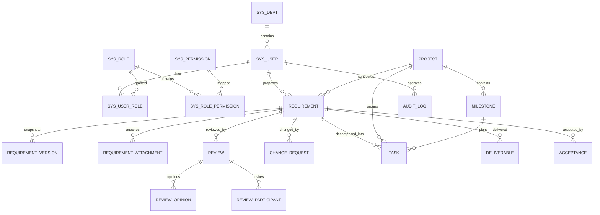

# ReqFlow 数据库设计说明

| 项目   | 内容                                         |
| ---- | ------------------------------------------ |
| 文档编号 | REQFLOW-DB-001                             |
| 版本   | V1.0                                       |
| 编写日期 | 2025-11-11                                 |
| 数据库  | H2 2.2（默认，MySQL 兼容模式）/ MySQL 8             |
| 迁移工具 | Flyway                                     |
| 脚本位置 | `backend/src/main/resources/db/migration/` |

---

## 1. 设计原则

1. **单据为骨**：需求单是聚合根，评审单、变更单、任务、交付物、验收单通过 `requirement_id` 挂在需求下，形成可追溯的单据链。
2. **状态为魂**：状态字段只由服务端状态机修改，前端不提交目标状态。
3. **留痕优先**：关键操作写审计日志；业务版本单独快照，能回答“谁在什么时间改了什么”。
4. **简单够用**：单库、单表、不引入分库分表；不使用物理外键，关系由服务层与索引保证。
5. **约定统一**：主键、审计字段、逻辑删除、乐观锁、编号规则、枚举编码全部统一。

---

## 2. 命名与通用字段

### 2.1 命名规范

| 对象   | 规范                           | 示例                                        |
| ---- | ---------------------------- | ----------------------------------------- |
| 表名   | 小写下划线，按域前缀                   | `requirement`、`review_opinion`、`sys_user` |
| 主键   | `id`，`BIGINT AUTO_INCREMENT` | `id`                                      |
| 业务编号 | `xxx_no`，唯一索引                | `req_no`、`task_no`                        |
| 外键列  | `关联实体_id`                    | `requirement_id`、`project_id`             |
| 状态列  | `status`，存枚举编码               | `ANALYZING`                               |
| 时间列  | `xxx_at` / `xxx_date`        | `created_at`、`plan_date`                  |
| 布尔语义 | `INT`，0/1                    | `deleted`、`builtin`                       |

### 2.2 通用字段

| 字段           | 类型       | 说明                     |
| ------------ | -------- | ---------------------- |
| id           | BIGINT   | 自增主键                   |
| created_at   | DATETIME | 创建时间，MyBatis-Plus 自动填充 |
| updated_at   | DATETIME | 更新时间，自动填充              |
| created_by   | BIGINT   | 创建人，自动填充               |
| updated_by   | BIGINT   | 更新人，自动填充               |
| deleted      | INT      | 逻辑删除，0 正常、1 删除         |
| lock_version | INT      | 乐观锁版本，仅需求表使用           |

说明：

- 枚举统一存 `VARCHAR` 编码（如 `PENDING_REVIEW`），不存数字，便于排查与跨库迁移；
- 工时、时长使用 `DECIMAL(10,1)`，避免浮点误差；
- 金额与工时类字段当前无独立汇总表，实际工时直接记在任务上。

---

## 3. 实体关系

---

## 4. 表清单

共 20 张表：系统域 7 张、需求域 7 张、交付域 5 张、审计 1 张。

### 4.1 系统域

| 表名                    | 中文名  | 用途              | 关键字段                                                                                 |
| --------------------- | ---- | --------------- | ------------------------------------------------------------------------------------ |
| `sys_dept`            | 部门   | 组织树，DEPT 数据权限依据 | `name`、`parent_id`、`sort`                                                            |
| `sys_user`            | 用户   | 账号、密码、锁定状态      | `username`、`password`、`dept_id`、`status`、`fail_count`、`lock_until`、`must_change_pwd` |
| `sys_role`            | 角色   | 7 类内置角色         | `code`、`name`、`data_scope`、`builtin`                                                 |
| `sys_permission`      | 权限点  | 38 个权限点，含 13 个动作级权限点 | `code`、`name`、`module`                                                               |
| `sys_user_role`       | 用户角色 | 多对多关联           | `user_id`、`role_id`                                                                  |
| `sys_role_permission` | 角色权限 | 角色与权限点关联        | `role_id`、`permission_id`                                                            |
| `sys_sequence`        | 编号序列 | 业务编号原子自增        | `seq_key`、`seq_date`、`seq_value`                                                     |

### 4.2 需求域

| 表名                       | 中文名  | 用途      | 关键字段                                                                           |
| ------------------------ | ---- | ------- | ------------------------------------------------------------------------------ |
| `requirement`            | 需求单  | 核心单据    | `req_no`、`title`、`status`、`version_no`、`lock_version`                          |
| `requirement_version`    | 需求版本 | 基线快照    | `requirement_id`、`version`、`reason`、`snapshot_json`                            |
| `requirement_attachment` | 需求附件 | 通用附件登记  | `requirement_id`、`file_name`、`stored_name`、`file_size`                         |
| `review`                 | 评审单  | 评审组织与结论 | `review_no`、`requirement_id`、`host_id`、`status`、`snapshot_json`                |
| `review_participant`     | 评审参与人 | 评审人关联表  | `review_id`、`user_id`、`participant_type`（唯一索引 `review_id + user_id`）           |
| `review_opinion`         | 评审意见 | 逐人意见    | `review_id`、`reviewer_id`、`result`、`content`                                   |
| `change_request`         | 变更单  | 变更申请与审批 | `change_no`、`requirement_id`、`impact_hours`、`status`                           |

### 4.3 交付域

| 表名            | 中文名 | 用途      | 关键字段                                                                      |
| ------------- | --- | ------- | ------------------------------------------------------------------------- |
| `project`     | 项目  | 交付项目    | `project_no`、`name`、`pm_id`、`status`                                      |
| `milestone`   | 里程碑 | 项目计划节点  | `project_id`、`name`、`plan_date`、`actual_date`                             |
| `task`        | 任务  | 任务分解与执行 | `task_no`、`requirement_id`、`assignee_id`、`task_type`、`status`、`plan_date` |
| `deliverable` | 交付物 | 交付物登记   | `deliverable_no`、`requirement_id`、`deliverable_type`、`stored_name`        |
| `acceptance`  | 验收单 | 验收轮次与结论 | `acceptance_no`、`requirement_id`、`round_no`、`acceptor_id`、`status`        |

### 4.4 审计域

| 表名          | 中文名  | 用途     | 关键字段                                                                                                                       |
| ----------- | ---- | ------ | -------------------------------------------------------------------------------------------------------------------------- |
| `audit_log` | 审计日志 | 关键操作留痕 | `user_id`、`username`、`role_codes`、`ip`、`uri`、`module`、`action`、`object_type`、`object_id`、`result`、`duration_ms`、`trace_id` |

---

## 5. 核心表字段说明

### 5.1 requirement（需求单）

| 字段                        | 类型                | 必填  | 说明                        |
| ------------------------- | ----------------- | --- | ------------------------- |
| id                        | BIGINT            | 是   | 主键                        |
| req_no                    | VARCHAR(30)       | 是   | 需求编号，唯一，`REQ-yyyyMM-xxxx` |
| title                     | VARCHAR(120)      | 是   | 需求标题                      |
| req_type                  | VARCHAR(30)       | 是   | 需求类型                      |
| req_source                | VARCHAR(30)       | 是   | 需求来源                      |
| dept_id                   | BIGINT            | 是   | 业务部门，DEPT 权限依据            |
| proposer_id               | BIGINT            | 是   | 提出人                       |
| analyst_id                | BIGINT            | 否   | 分析人，受理后写入                 |
| pm_id                     | BIGINT            | 否   | 项目经理，排期后写入                |
| priority                  | VARCHAR(10)       | 是   | P0–P3                     |
| expect_date               | DATE              | 否   | 期望交付日期，提交时必填              |
| plan_date                 | DATE              | 否   | 计划上线日期，排期时填写              |
| business_background       | TEXT              | 否   | 业务背景                      |
| req_description           | TEXT              | 否   | 需求描述                      |
| acceptance_criteria       | TEXT              | 否   | 验收标准                      |
| status                    | VARCHAR(30)       | 是   | 14 个状态之一                  |
| hold_from_status          | VARCHAR(30)       | 否   | 挂起前状态                     |
| version_no                | VARCHAR(10)       | 是   | 业务版本 `V0.1`、`V1.0`、`V1.1` |
| change_count              | INT               | 是   | 生效变更次数                    |
| project_id                | BIGINT            | 否   | 关联项目                      |
| milestone_id              | BIGINT            | 否   | 关联里程碑                     |
| tags                      | VARCHAR(100)      | 否   | 标签，逗号分隔                   |
| archived_at / archived_by | DATETIME / BIGINT | 否   | 归档时间与归档人                  |
| reject_reason             | VARCHAR(500)      | 否   | 评审驳回原因                    |
| lock_version              | INT               | 是   | 乐观锁版本，默认 0                |
| deleted                   | INT               | 是   | 逻辑删除                      |

> `version_no` 是业务版本，`lock_version` 是并发版本，两者语义不同，禁止混用。

### 5.2 requirement_version（版本快照）

| 字段             | 说明                            |
| -------------- | ----------------------------- |
| requirement_id | 所属需求                          |
| version        | 版本号，如 `V1.0`                  |
| reason         | 产生原因：评审通过 / 变更生效 / 驳回后修改      |
| snapshot_json  | 标题、类型、优先级、日期、描述、验收标准等 JSON 副本 |
| operator_id    | 操作人                           |
| created_at     | 生成时间                          |

快照存 JSON 而非拆列：历史版本只读、只用于追溯，不需要按字段查询。

### 5.3 review / review_opinion（评审）

| 表              | 关键字段             | 说明                                |
| -------------- | ---------------- | --------------------------------- |
| review         | `review_no`      | `RV-yyyyMM-xxxx`，唯一               |
| review         | `requirement_id` | 关联需求                              |
| review         | `host_id`        | 主持人                               |
| review         | `status`         | `PENDING` / `PASSED` / `REJECTED` |
| review         | `conclusion`     | `PASS` / `REJECT`                 |
| review         | `snapshot_json`  | 发起时的需求快照                          |
| review_participant | `review_id + user_id` | 评审人关联表，唯一索引，支持按人检索 |
| review_opinion | `result`         | `PASS` / `NEED_CHANGE` / `REJECT` |

评审人使用 `review_participant` 关联表而不是逗号分隔串：满足第一范式，`user_id` 可建索引，
数据权限与“我的评审”直接走索引查询，不再依赖 `like '%,id,%'` 的全表扫描。

### 5.4 change_request（变更单）

| 字段                         | 说明                                              |
| -------------------------- | ----------------------------------------------- |
| change_no                  | `CHG-yyyyMM-xxxx`                               |
| requirement_id             | 关联需求                                            |
| reason / content           | 变更原因与内容                                         |
| impact_hours               | 影响工时，`DECIMAL(10,1)`                            |
| impact_desc                | 影响范围描述                                          |
| status                     | `PENDING` / `APPROVED` / `REJECTED` / `APPLIED` |
| applicant_id / approver_id | 申请人与审批人                                         |
| approved_at / applied_at   | 审批与生效时间                                         |

### 5.5 task（任务）

| 字段                            | 说明                                                        |
| ----------------------------- | --------------------------------------------------------- |
| task_no                       | `TSK-yyyyMM-xxxx`                                         |
| requirement_id                | 关联需求                                                      |
| project_id / milestone_id     | 项目与里程碑                                                    |
| parent_id                     | 父任务，支持一层子任务                                               |
| task_type                     | `ANALYSIS` / `DEV` / `TEST` / `DOC` / `DEPLOY`            |
| assignee_id                   | 负责人                                                       |
| estimate_hours / actual_hours | 预估/实际工时                                                   |
| status                        | `TODO` / `IN_PROGRESS` / `DONE` / `BLOCKED` / `CANCELLED` |
| block_reason / finish_note    | 阻塞原因 / 完成说明                                               |
| plan_date / finished_at       | 计划日期 / 完成时间                                               |

### 5.6 deliverable / acceptance（交付与验收）

| 表           | 字段                     | 说明                                                                                                             |
| ----------- | ---------------------- | -------------------------------------------------------------------------------------------------------------- |
| deliverable | `deliverable_no`       | `DLV-yyyyMM-xxxx`                                                                                              |
| deliverable | `deliverable_type`     | `SPEC` / `REVIEW_RECORD` / `TEST_REPORT` / `DEPLOY_DOC` / `ACCEPTANCE` / `CLOSURE` / `CHANGE_RECORD` / `OTHER` |
| deliverable | `stored_name`          | UUID 落盘名                                                                                                       |
| acceptance  | `acceptance_no`        | `ACC-yyyyMM-xxxx`                                                                                              |
| acceptance  | `round_no`             | 验收轮次，从 1 递增                                                                                                    |
| acceptance  | `deliverable_snapshot` | 发起验收时的交付物清单                                                                                                    |
| acceptance  | `status`               | `PENDING` / `PASSED` / `FAILED`                                                                                |
| acceptance  | `rework_requirement`   | 返工要求，不通过时必填                                                                                                    |

必备交付物为 `SPEC`、`TEST_REPORT`、`DEPLOY_DOC` 三类，在发起验收与归档时校验。

### 5.7 audit_log（审计日志）

| 字段                              | 说明                           |
| ------------------------------- | ---------------------------- |
| user_id / username / role_codes | 操作人及其角色                      |
| ip / uri / method               | 请求来源                         |
| module / action                 | 业务模块与动作                      |
| object_type / object_id         | 业务对象，如 `REQUIREMENT` / `123` |
| result                          | `SUCCESS` / `FAIL`           |
| error_msg                       | 失败原因，截断 480 字符               |
| duration_ms                     | 耗时                           |
| trace_id                        | 8 位追踪号                       |
| created_at                      | 操作时间                         |

审计日志只追加，不提供更新与删除接口；写入使用 `REQUIRES_NEW` 独立事务。

---

## 6. 索引设计

| 表              | 索引                            | 用途                |
| -------------- | ----------------------------- | ----------------- |
| requirement    | `uk_req_no`                   | 编号唯一              |
| requirement    | `idx_req_status`              | 状态筛选、看板分组         |
| requirement    | `idx_req_dept`                | 部门数据权限            |
| requirement    | `idx_req_proposer`            | SELF 数据权限         |
| requirement    | `idx_req_analyst`             | DEPT/PROJECT 数据权限 |
| requirement    | `idx_req_pm`                  | PROJECT 数据权限      |
| requirement    | `idx_req_project`             | 项目维度查询            |
| task           | `idx_task_requirement`        | 需求任务列表、提交测试校验     |
| task           | `idx_task_assignee`           | 我的任务、PROJECT 数据权限 |
| review         | `idx_review_requirement`      | 需求详情评审列表          |
| change_request | `idx_change_requirement`      | 需求详情变更列表          |
| deliverable    | `idx_deliverable_requirement` | 必备交付物校验           |
| acceptance     | `idx_acceptance_requirement`  | 验收轮次与详情           |
| audit_log      | `idx_audit_object`            | 按对象查时间线           |
| audit_log      | `idx_audit_user`              | 按操作人查询            |

说明：

- 未建物理外键，避免单库演示与信创数据库迁移时的约束差异；
- 组合索引（如 `status + dept_id`）在数据量上升后可按查询计划补充；
- 审计日志按月归档可避免单表无限增长。

---

## 7. 迁移与初始化

| 脚本                         | 内容                              |
| -------------------------- | ------------------------------- |
| `V1__schema.sql`           | 19 张表、唯一约束、索引                   |
| `V2__seed.sql`             | 演示用户、角色、权限点、需求与任务等初始数据          |
| `V3__requirement_lock.sql` | `requirement.lock_version` 乐观锁列 |
| `V4__review_participant_and_action_permissions.sql` | 评审参与人关联表（含存量数据迁移）、13 个动作级权限点与角色授权 |

规则：

1. 已执行脚本不可修改，变更必须新增 `V4__xxx.sql`；
2. 首次启动自动建表并写入演示数据；
3. 重置演示数据：停止应用，删除 `backend/data`，重新启动；
4. MySQL 与 H2 复用同一套脚本，避免双份 DDL 漂移。

---

## 8. 容量、备份与演进

### 8.1 容量假设

| 表           | 预估量级  | 说明         |
| ----------- | ----- | ---------- |
| requirement | 10 万  | 单表示例规模     |
| task        | 50 万  | 需求平均 5 个任务 |
| audit_log   | 100 万 | 需要按月归档     |
| sys_*       | 百级    | 组织与权限数据    |

### 8.2 备份

- H2：备份 `backend/data/reqflow.mv.db` 文件；
- MySQL：`mysqldump` 每日备份，保留 7 天；
- 附件：备份 `reqflow.storage.path` 目录；
- 恢复演练：恢复数据库 + 附件目录，验证登录、需求详情、附件下载。

### 8.3 已知限制

- 无独立工时表，实际工时记录在任务上，不能按天/人明细汇总；
- 无通知表、评论表，站内通知与评论未实现；
- `review_participant` 目前只承载评审人一种类型，主持人仍单独存在 `review.host_id`；
- 未引入分区、分库分表，超出演示规模后需要改造。
